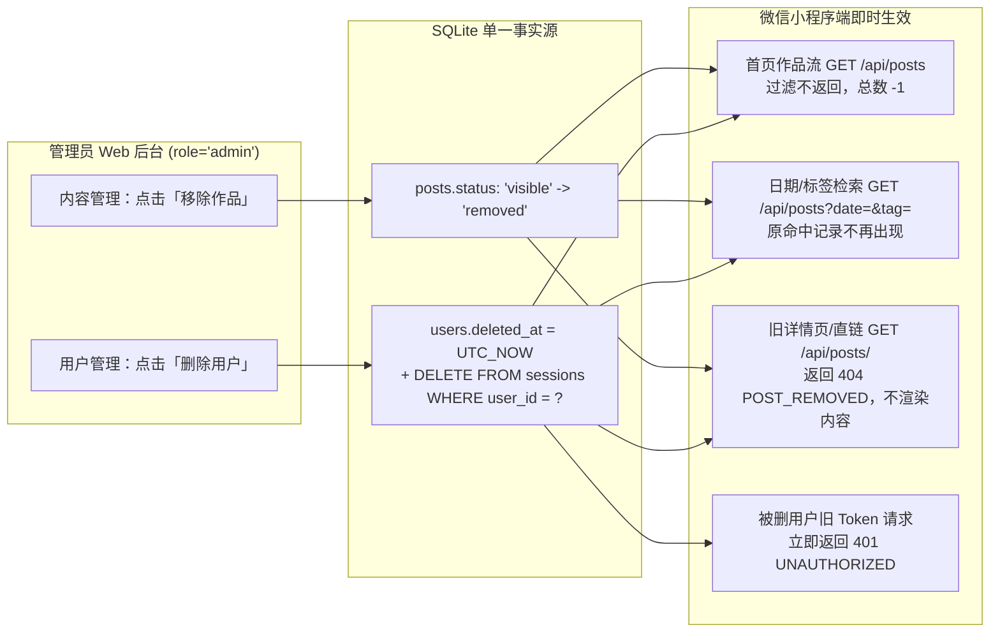
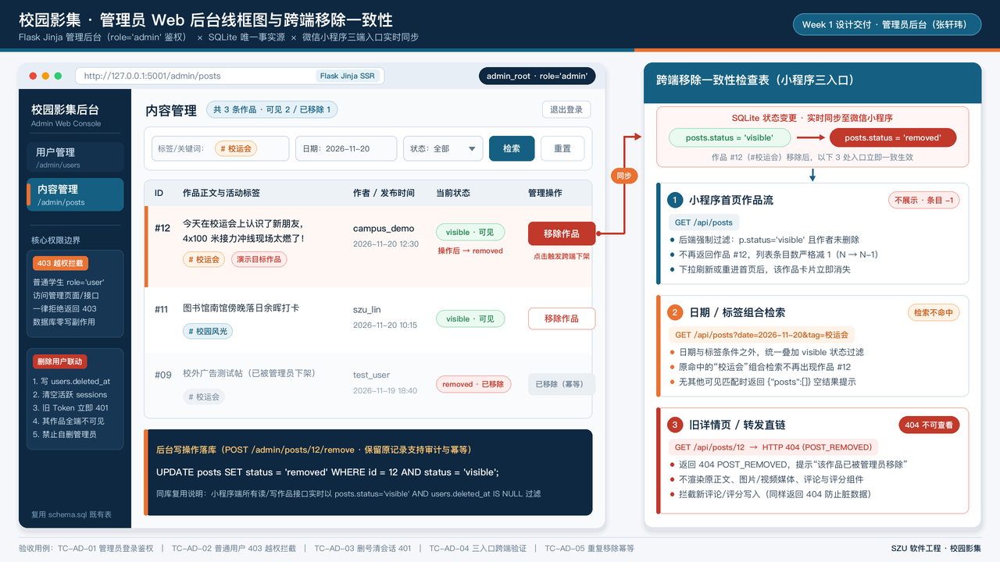

# 校园影集 · 管理员 Web 后台设计文档（第 1 周）

- **项目名称**：校园影集（深圳大学软件工程课程项目）
- **负责模块**：管理员 Web 后台（负责人：张轩玮）
- **基线版本**：Week 1 设计与联调基线（第 1 周输出页面草图、权限边界、状态流转、跨端移除一致性检查表与验收用例；第 3 周完成 Flask Jinja 模板与管理接口落地）
- **架构约束**：与微信小程序共用同一 Flask 后端（`backend/campus_album`）与 SQLite 数据库（`backend/instance/campus-album.sqlite3`），严格复用 `backend/campus_album/schema.sql` 既有字段，不引入重复鉴权体系或冗余数据表。

---

## 1. 模块目标与页面结构

### 1.1 模块目标
管理员 Web 后台面向校园内容审核与账号运维人员，使用 Flask + Jinja2 服务端模板渲染实现轻量、易维护的 PC 端管理控制台，核心目标包括：
1. **严格权限隔离**：仅 `users.role = 'admin'` 且未被删除（`deleted_at IS NULL`）的账号可登录并操作后台；普通学生（`role = 'user'`）访问任意管理页面或管理接口一律返回 HTTP `403`。
2. **账号生命周期治理**：支持按用户名查询、查看账号状态并逻辑删除违规账号，同时即时清空其活跃会话，阻止旧登录态继续使用小程序。
3. **内容审核与跨端同步**：支持按关键词、日期、标签（如“校运会”）和状态检索作品，执行逻辑移除操作并确保微信小程序的**首页作品流、日期/标签检索、旧详情页/直链**三处入口即时一致生效。

### 1.2 页面结构与路由规划（Flask Jinja 模板）

第 3 周落地时新增蓝图 `backend/campus_album/admin.py`（前缀 `/admin`）及模板目录 `backend/campus_album/templates/admin/`：

| 页面 / 接口 | HTTP 方法与路径 | 模板 / 响应类型 | 核心功能与交互要点 |
|---|---|---|---|
| 管理员登录页 | `GET /admin/login`<br>`POST /admin/login` | `admin/login.html`<br>成功重定向 `/admin/posts` | 输入管理员用户名与密码；校验 `password_hash`、`deleted_at IS NULL` 及 `role = 'admin'`；签发会话并写入 `HttpOnly` Cookie；普通学生账号尝试登录返回 `403`。 |
| 管理员退出 | `POST /admin/logout` | 重定向 `/admin/login` | 删除 `sessions` 中当前令牌摘要并清除 Cookie。 |
| 用户管理页 | `GET /admin/users` | `admin/users.html` | 顶部搜索栏（按用户名模糊搜索、状态筛选：`全部 / 正常 / 已删除`）；表格展示 `ID`、`用户名`、`角色`、`注册时间`、`作品数`、`状态`、`操作`；正常普通用户行提供「删除用户」按钮与二次确认弹窗。 |
| 删除用户操作 | `POST /admin/users/<id>/delete` | 重定向或 JSON（支持 AJAX） | 置 `users.deleted_at` 为当前 UTC 时间并清空该用户在 `sessions` 中的全部活跃记录；禁止管理员删除自身账号（返回 `400`）。 |
| 内容管理页 | `GET /admin/posts` | `admin/posts.html` | 后台默认主界面；筛选栏支持关键词/作者、日期、标签（如“校运会”）、状态（`visible / removed`）；表格展示 `ID`、`作品摘要`、`标签`、`作者`、`发布时间`、`状态标记`、`操作`；可见作品提供红色「移除作品」按钮与确认提示，已移除作品显示灰色「已移除」徽章。 |
| 移除作品操作 | `POST /admin/posts/<id>/remove` | 重定向或 JSON（支持 AJAX） | 将 `posts.status` 置为 `'removed'`；对已移除作品重复提交保持幂等返回，不抛异常。 |
| 越权错误页 | （鉴权拦截器统一返回） | `admin/403.html` 或 JSON `403` | 普通学生访问任何 `/admin/*` 页面或管理接口时返回 HTTP `403`，提示“仅管理员可访问后台”。 |

> **模板分层建议（供第 3 周编码复用）**：
> - `templates/admin/base.html`：统一顶部导航栏（校园影集管理后台 + 当前管理员名 + 退出按钮）与左侧固定导航栏（用户管理 `/admin/users`、内容管理 `/admin/posts`），沿用团队主色深海蓝 `#0E2841` 与青蓝 `#156082`。
> - `templates/admin/login.html`：居中登录卡片与错误提示横幅（复用统一错误文案）。
> - `templates/admin/users.html`、`templates/admin/posts.html`、`templates/admin/403.html`：继承 `base.html`。
> - 管理员初始化命令（第 3 周新增 CLI）：`flask --app backend/campus_album create-admin --username <name>`，以 `role = 'admin'` 写入 `users` 表，避免通过公开注册接口（强制 `role = 'user'`）提权。

### 1.3 角色权限矩阵与 `403` 拦截策略

后端抽取统一装饰器 `require_admin()`，同时兼容 Web 后台 `HttpOnly` Cookie 会话与 API 调试时的 `Authorization: Bearer <token>` 请求头（均经 SHA-256 摘要后查 `sessions JOIN users`）：

| 请求身份 | 数据库条件 | 访问 `/admin/users`、`/admin/posts` 及写操作 | 响应形式（HTML 页面 / JSON 接口） |
|---|---|---|---|
| 未登录 / Token 过期 / 已被清空 | 无匹配 `sessions` 或 `expires_at <= now` | 拒绝访问 | 页面：`302` 跳转 `/admin/login`<br>JSON API：`401` `{"error":{"code":"UNAUTHORIZED","message":"登录状态无效或已过期，请重新登录"}}` |
| 已删除账号 | `users.deleted_at IS NOT NULL` | 拒绝访问（会话已清空且校验不通过） | 页面：`302` 跳转 `/admin/login`<br>JSON API：`401` `{"error":{"code":"UNAUTHORIZED","message":"登录状态无效或已过期，请重新登录"}}` |
| 普通学生账号 | `users.role = 'user'` 且 `deleted_at IS NULL` | **强制拦截（`403`）** | 页面：HTTP `403` 渲染 `admin/403.html`（显示“权限不足：仅管理员可访问”）<br>JSON API：`403` `{"error":{"code":"FORBIDDEN","message":"权限不足，仅管理员可执行该操作"}}` |
| 管理员账号 | `users.role = 'admin'` 且 `deleted_at IS NULL` | 允许访问并执行管理操作 | `200` / `302` 正常响应 |

> **关键安全边界**：普通学生即使通过小程序 `POST /api/auth/login` 拿到了合法的 Bearer Token，或者在浏览器中直接输入 `/admin/login` 提交自己的学号/账号，或直接向 `POST /admin/posts/<id>/remove`、`POST /admin/users/<id>/delete` 发送请求，后端均先验证身份再严格校验 `user["role"] == "admin"`，不满足时一律返回 HTTP `403`，**不修改任何数据库记录**。

---

## 2. 数据库字段复用与核心状态流转

### 2.1 严格复用 `schema.sql` 既有结构

本模块不改动第 1 周既有核心表定义，直接复用 `backend/campus_album/schema.sql` 中的关键字段与约束：

| 数据表 | 复用字段与约束 | 在管理员后台中的作用 |
|---|---|---|
| `users` | `role TEXT NOT NULL DEFAULT 'user' CHECK (role IN ('user', 'admin'))` | 区分普通学生与管理员，作为 `403` 越权拦截的唯一角色依据。 |
| `users` | `deleted_at TEXT`（UTC ISO-8601，默认 `NULL`） | 逻辑删除用户标记；非空即视为已停用，禁止登录且其历史作品对外不可见。 |
| `sessions` | `token_digest TEXT PRIMARY KEY`, `user_id FK`, `expires_at TEXT` | 存储登录令牌 SHA-256 摘要与过期时间；删除用户时按 `user_id` 立即清空所有活跃会话。 |
| `posts` | `status TEXT NOT NULL DEFAULT 'visible' CHECK (status IN ('visible', 'removed'))` | 作品可见性状态；管理员移除作品时由 `'visible'` 转为 `'removed'`，保留审计原记录。 |

### 2.2 核心状态流转设计

#### 流程 A：管理员移除作品（`visible -> removed`）
1. 管理员在「内容管理」页点击目标作品（如“校运会”作品）的红色「移除作品」按钮并确认。
2. 后端 `require_admin()` 校验通过后查询 `SELECT id, status FROM posts WHERE id = ?`：
   - 若记录不存在：返回 `404` `{"error":{"code":"POST_NOT_FOUND","message":"作品不存在"}}`。
   - 若当前 `status = 'removed'`：**幂等处理**，返回 `200`（或页面提示“该作品已处于移除状态”），不抛出服务端错误，不产生重复副作用。
   - 若当前 `status = 'visible'`：执行原子更新并提交事务：
     ```sql
     UPDATE posts
     SET status = 'removed'
     WHERE id = ? AND status = 'visible';
     ```
3. 事务提交后，后台列表该行状态标记刷新为灰色「已移除」，小程序端所有读接口立即按 `posts.status = 'visible'` 过滤生效。

#### 流程 B：管理员删除用户并强制会话失效
1. 管理员在「用户管理」页检索目标用户并点击「删除用户」确认。
2. 后端 `require_admin()` 校验通过后检查目标用户：
   - 若 `target_id == current_admin["id"]`：拒绝自删，返回 `400` `{"error":{"code":"CANNOT_DELETE_SELF","message":"不能删除当前登录的管理员账号"}}`。
   - 若目标用户不存在：返回 `404` `{"error":{"code":"USER_NOT_FOUND","message":"用户不存在"}}`。
   - 若 `deleted_at IS NOT NULL`：幂等返回提示“该用户已删除”。
3. 在**同一个 SQLite 事务**内连续执行两条写操作并 `COMMIT`：
   ```sql
   UPDATE users
   SET deleted_at = strftime('%Y-%m-%dT%H:%M:%SZ', 'now')
   WHERE id = ? AND deleted_at IS NULL;

   DELETE FROM sessions
   WHERE user_id = ?;
   ```
4. 立即产生的跨端效果：
   - **旧 Token 立即失效（`401`）**：该用户在小程序持有的任何旧 Bearer Token 在下次调用受保护接口（如 `POST /api/posts`、发评论、打分）时，因 `sessions` 中记录已被清空且 `u.deleted_at IS NOT NULL`，立即被 `require_auth()` 拦截并返回 `401 UNAUTHORIZED`。
   - **无法再次登录**：`POST /api/auth/login` 查询 `WHERE username = ? AND deleted_at IS NULL` 查无匹配，返回 `401 INVALID_CREDENTIALS`，阻止已删除账号重新获取令牌。
   - **作品在小程序端不可见**：小程序作品流、检索与详情查询均带有 `JOIN users u ON u.id = p.author_id` 及 `u.deleted_at IS NULL` 过滤条件，该用户历史发布的作品同步从小程序端全部隐藏（同时保留数据库记录便于后台审计）。



---

## 3. 跨端移除一致性检查表（重点交付）

> **设计原则**：管理员后台与微信小程序共享同一个 SQLite 数据库，`posts.status` 与 `users.deleted_at` 是全系统唯一的可见性事实源（Single Source of Truth）。任何对外读/写作品的接口都必须统一执行 `p.status = 'visible' AND u.deleted_at IS NULL` 校验，杜绝“首页删了但检索还能搜到”或“通过旧直链仍能看详情/继续评论”的跨端不一致问题。

### 3.1 管理员移除作品后的小程序三入口一致性检查表

假设测试样本为一条可见作品：作品 `id = 12`，作者 `campus_demo`，标签含 `校运会`，发布日期 `2026-11-20`，管理员在后台将其移除（`posts.status: 'visible' -> 'removed'`）：

| 检查序号 | 小程序端入口 | 对应后端接口与过滤条件 | 移除前表现（`status='visible'`） | 移除后预期表现（`status='removed'`） | 验收判定标准 |
|---|---|---|---|---|---|
| **1** | **首页作品流** | `GET /api/posts`<br>SQL 必含：`WHERE p.status = 'visible' AND u.deleted_at IS NULL ORDER BY p.created_at DESC, p.id DESC` | 返回包含 `id = 12` 的作品数组，列表总数为 $N$ 条。 | **不再返回该作品**，列表条目数严格减 1（变为 $N - 1$）；其余作品顺序不变。小程序下拉刷新或重进首页后，该卡片立即消失（若 $N - 1 = 0$ 则展示空态提示）。 | 返回数组中不存在 `id = 12`；`len(posts)` 较移除前恰好减少 1。 |
| **2** | **日期 / 标签检索** | `GET /api/posts?date=2026-11-20&tag=校运会`<br>SQL 在日期/标签条件外，强制拼接：`AND p.status = 'visible' AND u.deleted_at IS NULL` | 使用 `date=2026-11-20` 与 `tag=校运会` 组合检索可精准命中 `id = 12`。 | **原命中的“校运会”组合检索不再出现该作品**；若该条件下无其他可见作品，返回 `200 {"posts": []}`，小程序展示“暂无符合条件的校园作品”。 | 组合检索及单独按 `tag=校运会`、单独按 `date=2026-11-20` 检索均不返回 `id = 12`。 |
| **3** | **旧详情页 / 直链** | `GET /api/posts/12`<br>查询到记录但 `p.status = 'removed'`（或作者已删除）时拦截 | 返回 `200`，正常渲染正文、图片/视频媒体、标签、评论列表与评分汇总。 | **返回 HTTP `404`**，响应体为 `{"error":{"code":"POST_REMOVED","message":"该作品已被管理员移除"}}`；小程序展示提示页“**该作品已被管理员移除**”与「返回首页」按钮，**不渲染正文、媒体、评论或评分组件**。 | 状态码严格为 `404` 且 `error.code == "POST_REMOVED"`；页面 DOM 中不含原正文、媒体与互动区。 |

> **互动接口防穿透补充（与第 3 周评论/评分模块对齐）**：
> 若用户停留在旧详情页缓存中尝试提交评论或评分，后端 `POST /api/posts/<id>/comments` 与 `PUT /api/posts/<id>/rating` 同样校验 `p.status = 'visible' AND u.deleted_at IS NULL`，对已移除作品直接返回 HTTP `404`（`POST_REMOVED`），确保已下架作品无法继续写入评论或评分。

### 3.2 管理员删除用户后的跨端联动检查补充

| 检查项 | 涉及接口 | 删除前（`deleted_at IS NULL`） | 删除后（`deleted_at` 非空且 `sessions` 已清空） |
|---|---|---|---|
| 旧 Token 受保护请求 | `POST /api/posts` 等带 Bearer Token 请求 | `201` / `200` 正常通过 | 立即返回 `401` `UNAUTHORIZED`，小程序清空本地会话并引导重新登录 |
| 重新登录 | `POST /api/auth/login` | `200` 签发新 Token | 拒绝登录，返回 `401` `INVALID_CREDENTIALS` |
| 该用户历史作品 | `GET /api/posts`、组合检索、`GET /api/posts/<id>` | 正常可见 | 首页流不展示、日期/标签检索不命中、旧详情页返回 `404` 不可查看 |

---

## 4. 管理员后台页面草图与跨端同步示意图

下图展示了管理员 Web 后台的核心控制台界面（左侧：侧边栏导航、搜索筛选栏、含“校运会”作品的表格及红色「移除作品」按钮与状态标记）以及移除操作后 `posts.status: visible → removed` 在小程序三处入口同步生效的闭环流程（右侧）：



---

## 5. 管理员后台验收用例表（TC-AD-01 至 TC-AD-05）

本验收用例表覆盖登录鉴权、越权拒绝、用户查删与会话失效、作品移除与跨端三入口一致性、以及重复移除幂等处理，可直接用于课程文档模板与第 3 周自动化回归测试：

| 用例编号 | 用例名称 | 前置条件 | 操作步骤 | 预期响应与前端表现 | 数据库状态校验 |
|---|---|---|---|---|---|
| **TC-AD-01** | 管理员登录鉴权与未登录拦截 | 数据库已存在管理员账号 `admin_root`（`role='admin'`, `deleted_at IS NULL`）。 | 1. 未登录状态下直接访问 `GET /admin/posts`。<br>2. 在 `/admin/login` 提交错误密码。<br>3. 输入正确管理员用户名与密码提交登录。<br>4. 点击顶部「退出登录」（`POST /admin/logout`）。 | 1. 页面重定向至 `/admin/login`（API 请求返回 `401 UNAUTHORIZED`）。<br>2. 停留登录页并显示“用户名或密码错误”（接口 `401 INVALID_CREDENTIALS`）。<br>3. 登录成功跳转 `/admin/posts`，顶部显示 `admin_root`。<br>4. 退出后回登录页，再访问 `/admin/posts` 被拦截。 | 登录成功时 `sessions` 新增 1 条 `user_id = admin_root.id` 的哈希摘要记录；退出后该条 `sessions` 记录被删除。 |
| **TC-AD-02** | 普通用户越权拒绝（`403`） | 存在普通学生账号 `student_a`（`role='user'`, `deleted_at IS NULL`）及其有效小程序 Token；存在可见作品 `id = 12`。 | 1. 在 `/admin/login` 使用 `student_a` 正确密码尝试登录后台。<br>2. 携带 `student_a` 的有效 Bearer Token（或会话 Cookie）依次请求 `GET /admin/users`、`GET /admin/posts`、`POST /admin/posts/12/remove`、`POST /admin/users/2/delete`。 | 1. 拒绝进入后台，返回 HTTP `403` 与错误提示“权限不足，仅管理员可访问后台”。<br>2. 全部管理查询与写接口均返回 HTTP `403` 及统一错误体 `{"error":{"code":"FORBIDDEN","message":"权限不足，仅管理员可执行该操作"}}`。 | `posts(id=12).status` 仍为 `'visible'`；目标用户 `deleted_at` 仍为 `NULL`；无任何写操作生效。 |
| **TC-AD-03** | 用户查删与会话立即失效 | 管理员已登录后台；存在普通学生 `student_b`（`role='user'`）已通过小程序登录（持有有效 `token_b`，`sessions` 中有活跃记录）并已发布 1 条可见作品 `id = 15`。 | 1. 管理员进入 `/admin/users`，按用户名 `student_b` 搜索并确认命中。<br>2. 点击「删除用户」并二次确认（`POST /admin/users/<id>/delete`）。<br>3. 立即使用 `token_b` 调用 `POST /api/posts` 发布新文字。<br>4. 使用 `student_b` 账号密码调用 `POST /api/auth/login`。<br>5. 刷新小程序首页 `GET /api/posts` 及作品详情 `GET /api/posts/15`。 | 1. 用户列表精准展示 `student_b`。<br>2. 删除成功，后台状态变为「已删除」。<br>3. 旧 Token 发帖立即返回 `401 UNAUTHORIZED`。<br>4. 重新登录被拒，返回 `401 INVALID_CREDENTIALS`。<br>5. 小程序首页流不返回 `id = 15`，详情页返回 `404`。 | `users(student_b).deleted_at` 已写入非空 UTC 时间戳；`SELECT COUNT(*) FROM sessions WHERE user_id = student_b.id` 结果为 `0`。 |
| **TC-AD-04** | 作品查询移除及跨端三入口验证 | 管理员已登录后台；数据库中共有 $N$ 条可见作品（$N \ge 2$），其中作品 `id = 12` 含标签 `校运会`、发布日期 `2026-11-20`、状态 `visible`，且在小程序首页流、组合检索、详情页均可正常查看。 | 1. 管理员在 `/admin/posts` 输入标签/关键词“校运会”检索并定位作品 `id = 12`。<br>2. 点击红色「移除作品」并确认（`POST /admin/posts/12/remove`）。<br>3. 在小程序端依次验证三入口：<br>① 调用 `GET /api/posts` 刷新首页流；<br>② 调用 `GET /api/posts?date=2026-11-20&tag=校运会`；<br>③ 通过旧详情页/直链访问 `GET /api/posts/12`。 | 1. 后台筛选命中 `id = 12`。<br>2. 操作成功，后台状态标记更新为灰色「已移除」。<br>3. 小程序三处入口全部同步生效：<br>① 首页流不含 `id = 12`，总数严格变为 $N - 1$；<br>② “校运会”组合检索不再返回 `id = 12`；<br>③ 旧详情页返回 `404`（`code: "POST_REMOVED"`），页面显示“该作品已被管理员移除”，不渲染正文、媒体与评论评分。 | `posts(id=12).status` 由 `'visible'` 更新为 `'removed'`；数据库仍保留该行原记录以便审计；其他作品状态不变。 |
| **TC-AD-05** | 重复移除幂等处理与无效 ID 保护 | 管理员已登录后台；作品 `id = 12` 已被移除（`status = 'removed'`）；作品 `id = 99999` 不存在。 | 1. 管理员再次向 `POST /admin/posts/12/remove` 提交移除请求（模拟重复点击或重试）。<br>2. 向 `POST /admin/posts/99999/remove` 提交移除请求。 | 1. 不触发 `500` 错误，幂等返回 `200`（或重定向提示“该作品已处于移除状态”），前端状态稳定保持「已移除」。<br>2. 对不存在的 ID 返回 `404` `{"error":{"code":"POST_NOT_FOUND","message":"作品不存在"}}`。 | `posts(id=12).status` 保持 `'removed'`，表内其他记录行数与字段值无任何异常变更。 |

---

## 6. 第 3 周编码落地衔接清单

为确保第 1 周设计文档在第 3 周能够零摩擦转化为可运行代码，明确待交付代码与测试文件清单如下：
1. **后端蓝图**：新增 `backend/campus_album/admin.py`，导出 `bp = Blueprint("admin", __name__, url_prefix="/admin")`，复用 `db.get_db()`、`errors.error_response()` 与 `auth` 令牌摘要逻辑，实现 `require_admin()`、登录/退出、用户查删、作品查删及 CLI `create-admin` 命令，并在 `backend/campus_album/__init__.py` 注册蓝图。
2. **Jinja 模板**：在 `backend/campus_album/templates/admin/` 下实现 `base.html`、`login.html`、`users.html`、`posts.html`、`403.html`。
3. **跨端联调核对**：与黄子特（检索模块）确认 `GET /api/posts?date=&tag=` 必带 `p.status = 'visible' AND u.deleted_at IS NULL`；与江耿锐（评论评分模块）确认 `GET /api/posts/<id>` 及评论/评分接口对 `status = 'removed'` 统一返回 `404 POST_REMOVED`。
4. **自动化验收测试**：对照上表 `TC-AD-01` 至 `TC-AD-05` 编写后端与跨端集成测试，纳入最终联调回归验证。
