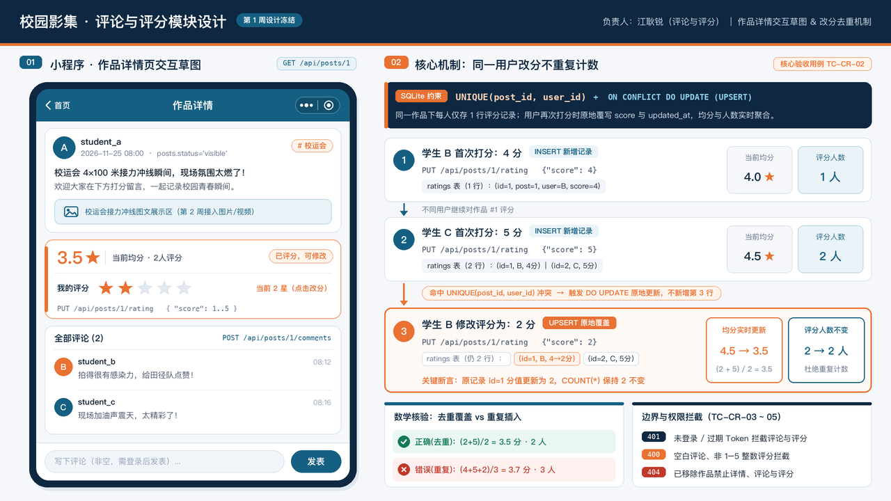

# 校园影集 · 评论与评分模块设计文档（第 1 周）

- **模块名称**：评论与评分（作品详情互动）
- **负责人**：江耿锐
- **适用阶段**：第 1 周设计冻结 → 第 3 周代码落地与联调验收
- **基线依据**：[`campus-album/README.md`](../../README.md)、[`backend/campus_album/schema.sql`](../../backend/campus_album/schema.sql)

---

## 1. 模块目标与边界

### 1.1 模块目标

围绕校园活动作品详情场景，为学生用户提供**文字评论**与 **1–5 星评分**两项核心互动能力，并保证在任意用户多次修改评分时，作品的**平均分实时更新、评分人数不重复计数**，为后续排行榜、热门活动推荐及管理员内容治理提供准确的数据真值。

### 1.2 分周边界与交付规划

| 迭代阶段 | 本模块范围与交付物 | 明确不做的范围（模块边界） |
|---|---|---|
| **第 1 周（当前阶段）** | 1. 作品详情页交互草图与改分数据流图（`assets/comments_ratings_wireframe.png`）<br>2. `comments` / `ratings` 数据表扩展 DDL<br>3. 详情聚合、评论提交、评分改分 REST API 契约<br>4. 验收用例表（TC-CR-01 至 TC-CR-05） | 不编写互动后端代码与详情页代码；不改动第 1 周账号登录、发纯文字作品与首页列表主链路 |
| **第 2 周（协同前置）** | 保持作品主键 `posts.id` 契约稳定，等待媒体上传（图片/视频）与活动标签字段合入 | 不介入文件存储、标签筛选逻辑 |
| **第 3 周（代码落地）** | 1. 将 `comments`、`ratings` DDL 合入 `schema.sql`<br>2. 新增后端蓝图 `backend/campus_album/interactions.py` 并注册至 `__init__.py`<br>3. 新增小程序作品详情页 `miniprogram/pages/detail/*` 并接入 `utils/api.js`<br>4. 编写自动化测试并完成 TC-CR-01 至 TC-CR-05 联调验收 | 不修改登录鉴权实现（复用 `auth.py` 的 `get_current_user()` / `require_auth()`）；不修改管理员移除状态机（仅读取 `posts.status` 与 `users.deleted_at`） |

### 1.3 交互草图与数据流示意



**小程序作品详情页（`pages/detail/detail`）核心交互状态**：
1. **游客态（未登录）**：可正常阅读作品内容、查看 `averageScore`、`ratingCount` 与评论列表；点击星星或发送评论时提示登录并跳转 `/pages/login/login`。
2. **已登录未评分态**：评分栏展示当前均分（无人评分时显示“暂无评分 · 0人评分”）与 5 颗空心星，提示“点击星级为作品评分”。
3. **已登录已评分态**：高亮显示当前用户的 `myScore` 星级，状态标签显示“已评分，可修改”，点击任意星级（1–5）即调用 `PUT /api/posts/<id>/rating` 原地更新分值并实时刷新均分与人数。
4. **作品已移除态**：当管理员将作品置为 `posts.status = 'removed'` 后，进入旧详情页直链收到 HTTP `404`（`POST_REMOVED`），页面展示“该作品已被管理员移除”，不渲染正文、评论列表及评分交互控件。

---

## 2. 数据表扩展设计（SQLite DDL）

本扩展严格遵循现有 `backend/campus_album/schema.sql` 规范：
- 全部建表与索引使用 `IF NOT EXISTS`，保证重复执行 `flask --app backend/campus_album init-db` 幂等且保留已有数据；
- 依赖 `db.py` 已开启的 `PRAGMA foreign_keys = ON`，通过外键约束保障引用完整性；
- 时间字段统一采用 UTC ISO-8601 字符串格式 `strftime('%Y-%m-%dT%H:%M:%SZ', 'now')`。

### 2.1 扩展 DDL（第 3 周追加至 `backend/campus_album/schema.sql`）

```sql
-- 评论表：一条作品可有多条评论，同一用户允许发表多条评论
CREATE TABLE IF NOT EXISTS comments (
    id INTEGER PRIMARY KEY,
    post_id INTEGER NOT NULL REFERENCES posts (id) ON DELETE CASCADE,
    author_id INTEGER NOT NULL REFERENCES users (id) ON DELETE CASCADE,
    body TEXT NOT NULL CHECK (length(trim(body)) > 0),
    created_at TEXT NOT NULL DEFAULT (strftime('%Y-%m-%dT%H:%M:%SZ', 'now'))
);

CREATE INDEX IF NOT EXISTS idx_comments_post_created
    ON comments (post_id, created_at ASC, id ASC);

-- 评分表：同一用户对同一作品仅允许保留一条评分记录（1-5 整数）
CREATE TABLE IF NOT EXISTS ratings (
    id INTEGER PRIMARY KEY,
    post_id INTEGER NOT NULL REFERENCES posts (id) ON DELETE CASCADE,
    user_id INTEGER NOT NULL REFERENCES users (id) ON DELETE CASCADE,
    score INTEGER NOT NULL CHECK (score BETWEEN 1 AND 5),
    updated_at TEXT NOT NULL DEFAULT (strftime('%Y-%m-%dT%H:%M:%SZ', 'now')),
    UNIQUE (post_id, user_id)
);

CREATE INDEX IF NOT EXISTS idx_ratings_post
    ON ratings (post_id);
```

### 2.2 字段设计说明

| 表名 | 字段 | 类型与约束 | 说明 |
|---|---|---|---|
| `comments` | `id` | `INTEGER PRIMARY KEY` | 评论自增主键 |
| `comments` | `post_id` | `INTEGER NOT NULL FK -> posts(id) ON DELETE CASCADE` | 所属作品 ID |
| `comments` | `author_id` | `INTEGER NOT NULL FK -> users(id) ON DELETE CASCADE` | 评论作者 ID（从登录会话取得，不由请求体伪造） |
| `comments` | `body` | `TEXT NOT NULL CHECK (length(trim(body)) > 0)` | 评论正文；应用层 `strip()` 后入库，数据库层再用 `CHECK` 兜底禁止空字符串或纯空白 |
| `comments` | `created_at` | `TEXT NOT NULL DEFAULT (strftime(...))` | 评论创建时间（UTC ISO-8601） |
| `ratings` | `id` | `INTEGER PRIMARY KEY` | 评分记录主键 |
| `ratings` | `post_id` | `INTEGER NOT NULL FK -> posts(id) ON DELETE CASCADE` | 被评分作品 ID |
| `ratings` | `user_id` | `INTEGER NOT NULL FK -> users(id) ON DELETE CASCADE` | 评分用户 ID（从登录会话取得） |
| `ratings` | `score` | `INTEGER NOT NULL CHECK (score BETWEEN 1 AND 5)` | 1 至 5 星整数分值 |
| `ratings` | `updated_at` | `TEXT NOT NULL DEFAULT (strftime(...))` | 首次评分或最近一次改分时间（UTC ISO-8601） |
| `ratings` | — | `UNIQUE (post_id, user_id)` | **核心联合唯一约束**：保证每个用户对同一作品最多存在 1 条评分记录 |

### 2.3 核心原理解析：为何 `UNIQUE(post_id, user_id)` + `UPSERT` 能保证改分不重复计数

在评分写入接口 `PUT /api/posts/<id>/rating` 中，后端直接执行 SQLite 原生原子 `UPSERT` 语句：

```sql
INSERT INTO ratings (post_id, user_id, score, updated_at)
VALUES (?, ?, ?, strftime('%Y-%m-%dT%H:%M:%SZ', 'now'))
ON CONFLICT (post_id, user_id) DO UPDATE SET
    score = excluded.score,
    updated_at = excluded.updated_at;
```

随后在同一次请求中执行实时聚合查询（过滤已软删除用户的评分，保持与全站用户删除逻辑一致）：

```sql
SELECT
    COUNT(r.id) AS rating_count,
    ROUND(AVG(r.score), 1) AS average_score
FROM ratings r
JOIN users u ON u.id = r.user_id
WHERE r.post_id = ? AND u.deleted_at IS NULL;
```

该组合设计从三个层面彻底消除“改分导致人数虚增、均分算错”的缺陷：
1. **数据库级唯一性兜底**：`UNIQUE(post_id, user_id)` 在 SQLite 存储引擎层强制 `(作品, 用户)` 最多只存在一行。即便前端发生网络重试或用户快速连点星星，也不可能插入第二条记录。
2. **单语句原子 `UPSERT` 消除竞态**：若采用“先 `SELECT` 判断是否存在、再决定 `INSERT` 或 `UPDATE`”的两步写法，并发请求下可能同时判空并触发唯一约束报错；使用 `ON CONFLICT (post_id, user_id) DO UPDATE` 在单条 SQL 内完成“无则插入、有则原地覆写 `score` 与 `updated_at`”，原行 `id` 保持不变、总行数不增。
3. **聚合值由真值表实时计算**：`ratingCount = COUNT(r.id)` 与 `averageScore = ROUND(AVG(r.score), 1)` 直接基于 `ratings` 唯一行集合计算，不在 `posts` 表冗余缓存总分/人数计数器，避免增量加减逻辑遗漏导致的统计漂移。

---

## 3. REST API 接口约定

### 3.1 通用契约（与第 1 周基线完全对齐）

- **协议与格式**：请求与响应均为 `application/json; charset=utf-8`，JSON 字段沿用小驼峰（`createdAt`、`averageScore`、`ratingCount`、`myScore`）。
- **鉴权方式**：通过请求头 `Authorization: Bearer <token>` 传递会话令牌。
  - 写接口（`POST /comments`、`PUT /rating`）调用 `auth.require_auth()` 强制校验登录态，未携带、格式错误、已过期或账号已软删除均返回 `401 UNAUTHORIZED`。
  - 详情读接口（`GET /api/posts/<id>`）调用 `auth.get_current_user()` 尝试识别用户：已登录则返回当前用户的 `myScore`；未登录或令牌无效时降级为游客视角，返回 `"myScore": null`，不影响浏览。
- **统一错误格式**：复用 `errors.error_response(code, message, status)`，固定返回：
  ```json
  {"error": {"code": "ERROR_CODE", "message": "面向用户的中文错误提示"}}
  ```
- **作品可见性统一前置校验**（所有 3 个接口共用）：
  1. 若 `posts` 中不存在该 `id`，或其作者 `users.deleted_at IS NOT NULL` → 返回 `404`，`code = "POST_NOT_FOUND"`，`message = "作品不存在"`。
  2. 若 `posts.status = 'removed'` → 返回 `404`，`code = "POST_REMOVED"`，`message = "该作品已被管理员移除"`（与管理员后台「跨端移除一致性检查表」完全一致）。

### 3.2 接口总览

| 方法与路径 | 鉴权要求 | 成功状态码 | 功能说明 |
|---|---|---|---|
| `GET /api/posts/<int:post_id>` | 可选（Bearer Token） | `200 OK` | 获取单个可见作品详情，聚合评论列表、`averageScore`、`ratingCount`、`myScore` |
| `POST /api/posts/<int:post_id>/comments` | 必填（Bearer Token） | `201 Created` | 对指定可见作品发表一条非空文字评论 |
| `PUT /api/posts/<int:post_id>/rating` | 必填（Bearer Token） | `200 OK` | 对指定可见作品提交或修改 1–5 星评分（幂等 UPSERT），返回最新评分统计 |

---

### 3.3 `GET /api/posts/<int:post_id>` — 作品详情聚合

- **请求头**：可选 `Authorization: Bearer <token>`
- **数据规则**：
  - `post` 对象复用 `serializers.serialize_post(row)` 格式（`id`, `text`, `author`, `createdAt`）；第 2 周接入图片/视频与标签字段时自动透传。
  - `comments` 数组仅返回未软删除作者（`u.deleted_at IS NULL`）的评论，按 `created_at ASC, id ASC` 正序排列；无评论时返回 `[]`。
  - `ratingCount` 为有效评分人数（整数，`>= 0`）；`averageScore` 在有评分时保留 1 位小数（如 `4.0`、`3.5`），无人评分时返回 `null`。
  - `myScore` 在当前请求已登录且用户评过分时返回 `1`–`5` 整数，否则返回 `null`。
- **成功响应（`200 OK`）**：

```json
{
  "post": {
    "id": 1,
    "text": "校运会 4×100 米接力冲线瞬间，现场氛围太燃了！",
    "author": {
      "id": 1,
      "username": "student_a"
    },
    "createdAt": "2026-11-25T08:00:00Z"
  },
  "averageScore": 3.5,
  "ratingCount": 2,
  "myScore": 2,
  "comments": [
    {
      "id": 10,
      "postId": 1,
      "text": "拍得很有感染力，给田径队点赞！",
      "author": {
        "id": 2,
        "username": "student_b"
      },
      "createdAt": "2026-11-25T08:12:00Z"
    },
    {
      "id": 11,
      "postId": 1,
      "text": "现场加油声震天，太精彩了！",
      "author": {
        "id": 3,
        "username": "student_c"
      },
      "createdAt": "2026-11-25T08:16:00Z"
    }
  ]
}
```

- **失败响应**：
  - `404` `POST_NOT_FOUND`：作品不存在或作者已注销
  - `404` `POST_REMOVED`：作品已被管理员移除（`{"error": {"code": "POST_REMOVED", "message": "该作品已被管理员移除"}}`）

---

### 3.4 `POST /api/posts/<int:post_id>/comments` — 发表评论

- **请求头**：必填 `Authorization: Bearer <token>`
- **请求体**：
  ```json
  {
    "text": "拍得很有感染力，给田径队点赞！"
  }
  ```
- **参数校验顺序**：
  1. 登录鉴权：失败返回 `401 UNAUTHORIZED`（`"登录状态无效或已过期，请重新登录"`）。
  2. 作品可见性校验：不存在返回 `404 POST_NOT_FOUND`；已移除返回 `404 POST_REMOVED`。
  3. 请求体校验：非 JSON 对象返回 `400 INVALID_INPUT`（`"请求格式无效"`）；`text` 非字符串或 `text.strip() == ""` 返回 `400 INVALID_INPUT`（`"请输入评论内容"`）；长度超过 500 字返回 `400 INVALID_INPUT`（`"评论内容不能超过 500 字"`）。
- **入库行为**：写入 `text.strip()` 至 `comments(post_id, author_id, body)`，提交事务并返回新评论对象。
- **成功响应（`201 Created`）**：

```json
{
  "comment": {
    "id": 10,
    "postId": 1,
    "text": "拍得很有感染力，给田径队点赞！",
    "author": {
      "id": 2,
      "username": "student_b"
    },
    "createdAt": "2026-11-25T08:12:00Z"
  }
}
```

---

### 3.5 `PUT /api/posts/<int:post_id>/rating` — 提交或修改评分

- **请求头**：必填 `Authorization: Bearer <token>`
- **请求体**：
  ```json
  {
    "score": 4
  }
  ```
- **参数校验顺序**：
  1. 登录鉴权：失败返回 `401 UNAUTHORIZED`。
  2. 作品可见性校验：不存在返回 `404 POST_NOT_FOUND`；已移除返回 `404 POST_REMOVED`。
  3. 分值校验：`score` 必须为严格整数且满足 `1 <= score <= 5`。
     - **实现注意**：Python 中 `isinstance(True, int)` 为 `True`，后端必须使用 `isinstance(score, int) and not isinstance(score, bool) and 1 <= score <= 5` 进行校验，拦截布尔值（`true`/`false`）、浮点数（`3.5`）、字符串（`"4"`）及越界整数（`0`、`-1`、`6`），统一返回 `400 INVALID_INPUT`（`"评分必须是 1 到 5 的整数"`）。
- **入库行为**：执行 `INSERT INTO ratings ... ON CONFLICT(post_id, user_id) DO UPDATE ...` 并提交事务，随即重算 `averageScore`、`ratingCount` 返回。
- **成功响应（`200 OK`）**：

```json
{
  "postId": 1,
  "myScore": 2,
  "averageScore": 3.5,
  "ratingCount": 2,
  "updatedAt": "2026-11-25T08:20:00Z"
}
```

### 3.6 错误码与小程序前端反馈约定

| HTTP 状态码 | `error.code` | 典型触发场景 | 小程序前端处理 |
|---|---|---|---|
| `400` | `INVALID_INPUT` | 评论为空/纯空格、超过 500 字；评分为 0/6/小数/非整数；非法 JSON | 保留在详情页当前输入状态，通过错误提示条展示 `error.message` |
| `401` | `UNAUTHORIZED` | 未登录、Token 格式错误、Token 过期或账号被管理员删除 | 清除本地失效会话，弹出提示并引导跳转 `/pages/login/login` |
| `404` | `POST_NOT_FOUND` | 作品 ID 不存在或作者已删除 | 展示“作品不存在”空态页，提供“返回首页”按钮 |
| `404` | `POST_REMOVED` | 管理员已将该作品置为 `status='removed'` | 展示“该作品已被管理员移除”，隐藏正文、评论及评分控件，提供“返回首页”按钮 |

---

## 4. 验收用例表（TC-CR-01 至 TC-CR-05）

### 4.1 验收用例总览

| 用例编号 | 用例名称 | 前置条件 | 测试操作 | 预期接口响应 | 数据库状态核验 |
|---|---|---|---|---|---|
| **TC-CR-01** | 登录用户发表评论与详情回显 | 存在可见作品 `#1`；学生 B 已登录 | 1. 学生 B 调用 `POST /api/posts/1/comments`，传入 `{"text": "  拍得很有感染力！  "}`<br>2. 调用 `GET /api/posts/1` 刷新详情页<br>3. 重启 Flask 服务后再次调用 `GET /api/posts/1` | 1. 返回 `201`，`comment.text` 已去首尾空白为 `"拍得很有感染力！"`，`author.username="student_b"`<br>2. 详情页 `comments` 包含该评论<br>3. 重启后仍完整回显 | `comments` 表新增 1 行，`post_id=1`，`author_id=2`，`body='拍得很有感染力！'` |
| **TC-CR-02** | **【核心】同一用户改分后，平均分更新、评分人数不变** | 存在可见作品 `#1`（初始无评分）；学生 B、学生 C 均已登录 | 1. 学生 B 首次打 4 分<br>2. 学生 C 打 5 分<br>3. 学生 B 改打 2 分<br>4. 分别以 B、C、游客视角查询 `GET /api/posts/1` | 1. `200`，`averageScore: 4.0, ratingCount: 1, myScore: 4`<br>2. `200`，`averageScore: 4.5, ratingCount: 2, myScore: 5`<br>3. `200`，`averageScore: 3.5, ratingCount: 2, myScore: 2`<br>4. 三视角均返回 `averageScore: 3.5, ratingCount: 2`，`myScore` 分别为 `2` / `5` / `null` | `ratings` 表中 `post_id=1` 始终只有 **2 行**（B 与 C 各 1 行）；B 的记录原地从 `score=4` 更新为 `score=2`，`id` 不变，未产生第 3 行 |
| **TC-CR-03** | 未登录 / 无效 Token 拦截 | 存在可见作品 `#1` | 1. 不带 `Authorization` 头调用 `POST /api/posts/1/comments` 与 `PUT /api/posts/1/rating`<br>2. 携带伪造 Token `Bearer invalid_tok` 重试上述两接口<br>3. 不带 Token 调用 `GET /api/posts/1` | 1. 两个写接口均返回 `401` 且 `error.code="UNAUTHORIZED"`<br>2. 均返回 `401` 且 `error.code="UNAUTHORIZED"`<br>3. 详情接口返回 `200`，正常展示作品与公开评论，`myScore: null` | `comments` 与 `ratings` 表无任何新增或变更行 |
| **TC-CR-04** | 超范围评分与空白评论参数拦截 | 存在可见作品 `#1`；学生 B 已登录 | 1. `PUT /api/posts/1/rating` 分别提交 `{"score": 0}`、`{"score": 6}`、`{"score": 3.5}`、`{"score": true}`<br>2. `POST /api/posts/1/comments` 分别提交 `{"text": ""}`、`{"text": "   \n\t  "}` | 1. 均返回 `400`，`error.code="INVALID_INPUT"`，`message="评分必须是 1 到 5 的整数"`<br>2. 均返回 `400`，`error.code="INVALID_INPUT"`，`message="请输入评论内容"` | `ratings` 与 `comments` 表数据完全不变；若 B 此前已有评分，原评分不被破坏 |
| **TC-CR-05** | 对管理员已移除作品互动被拒 | 作品 `#1` 已有评论与评分；管理员将其置为 `posts.status='removed'`；学生 B 已登录 | 1. 调用 `GET /api/posts/1`<br>2. 调用 `POST /api/posts/1/comments`（合法正文）<br>3. 调用 `PUT /api/posts/1/rating`（`{"score": 5}`） | 三处请求**全部**返回 `404`，统一错误体为 `{"error": {"code": "POST_REMOVED", "message": "该作品已被管理员移除"}}` | `comments` 与 `ratings` 表无新增或修改记录；小程序详情页隐藏正文与互动区并提示已移除 |

---

### 4.2 核心用例 TC-CR-02 详细推演（同一用户改分不重复计数）

**前置条件**：
- 作品 `post_id = 1`（标题/正文含“校运会”，作者 `student_a`，`posts.status = 'visible'`）；
- 测试账号 `student_b`（`user_id = 2`，令牌 `token_b`）与 `student_c`（`user_id = 3`，令牌 `token_c`）已登录；
- 初始 `ratings` 表中 `post_id = 1` 记录数为 `0`，`GET /api/posts/1` 返回 `averageScore: null, ratingCount: 0, myScore: null`。

| 步骤 | 操作主体与 HTTP 请求 | SQL 执行行为 | 预期 HTTP 响应（核心字段） | 数据库 `ratings` 表快照（`post_id = 1`） | 核验要点 |
|---|---|---|---|---|---|
| **步骤 1** | **学生 B 首次打 4 分**<br>`PUT /api/posts/1/rating`<br>`Authorization: Bearer <token_b>`<br>`{"score": 4}` | 未命中冲突，执行 `INSERT` 新增记录 `id=1` | `200 OK`<br>`{"postId": 1, "myScore": 4, "averageScore": 4.0, "ratingCount": 1, ...}` | 1 行：<br>`(id=1, post_id=1, user_id=2, score=4)` | 首次评分：`4 / 1 = 4.0`，人数变为 `1` |
| **步骤 2** | **学生 C 首次打 5 分**<br>`PUT /api/posts/1/rating`<br>`Authorization: Bearer <token_c>`<br>`{"score": 5}` | 未命中冲突，执行 `INSERT` 新增记录 `id=2` | `200 OK`<br>`{"postId": 1, "myScore": 5, "averageScore": 4.5, "ratingCount": 2, ...}` | 2 行：<br>`(id=1, post_id=1, user_id=2, score=4)`<br>`(id=2, post_id=1, user_id=3, score=5)` | 不同用户独立计数：`(4 + 5) / 2 = 4.5`，人数变为 `2` |
| **步骤 3** | **学生 B 改打 2 分（关键）**<br>`PUT /api/posts/1/rating`<br>`Authorization: Bearer <token_b>`<br>`{"score": 2}` | 命中 `UNIQUE(post_id, user_id)` 冲突，触发 `DO UPDATE` 原地覆写 `id=1` 的 `score` 与 `updated_at` | `200 OK`<br>`{"postId": 1, "myScore": 2, "averageScore": 3.5, "ratingCount": 2, ...}` | 仍为 **2 行**：<br>`(id=1, post_id=1, user_id=2, score=2)` *(已原地更新)*<br>`(id=2, post_id=1, user_id=3, score=5)` | **核心断言**：<br>• 均分从 `4.5` 更新为 `(2 + 5) / 2 = 3.5`<br>• 评分人数维持 `2` 不变（绝不变成 `3` 人或 `(4+5+2)/3 = 3.7`）<br>• 表行数 `COUNT(*) == 2`，且 `id=1` 主键不变 |
| **步骤 4** | **多视角回查与重启持久化**<br>1. B 调 `GET /api/posts/1`<br>2. C 调 `GET /api/posts/1`<br>3. 游客调 `GET /api/posts/1`<br>4. 重启 Flask 后重复 1–3 | 只读查询 `posts`、`ratings`、`comments` | 均返回 `200 OK`，`averageScore: 3.5, ratingCount: 2`；<br>`myScore` 分别为 `2`（B）、`5`（C）、`null`（游客） | 同步骤 3，重启服务前后记录与聚合结果完全一致 | 验证登录态隔离、跨请求一致性与 SQLite 持久化 |

---

## 5. 第 3 周代码落地复用清单

第 3 周编码阶段可直接按以下文件分工无缝接入现有工程：

1. **`backend/campus_album/schema.sql`**：追加本文第 2.1 节的 `comments`、`ratings` 建表与索引语句。
2. **`backend/campus_album/serializers.py`**：新增 `serialize_comment(row)`，输出 `{"id", "postId", "text", "author": {"id", "username"}, "createdAt"}`。
3. **`backend/campus_album/interactions.py`**：新增蓝图 `bp = Blueprint("interactions", __name__)`，复用 `db.get_db()`、`auth.get_current_user()`、`auth.require_auth()`、`errors.error_response()`、`serializers.serialize_post()`，实现：
   - `GET /api/posts/<int:post_id>`
   - `POST /api/posts/<int:post_id>/comments`
   - `PUT /api/posts/<int:post_id>/rating`
4. **`backend/campus_album/__init__.py`**：注册 `interactions_bp`。
5. **`miniprogram/utils/api.js`**：新增 `getPostDetail(postId)`、`createComment(postId, text)`、`upsertRating(postId, score)`。
6. **`miniprogram/pages/detail/detail.{js,json,wxml,wxss}`** & **`miniprogram/app.json`**：新增作品详情页并从首页作品卡片点击跳转进入。
7. **`tests/test_comments_ratings.py`**：以本文 TC-CR-01 至 TC-CR-05 为蓝本编写自动化 `unittest` 用例并纳入整组联调回归。
